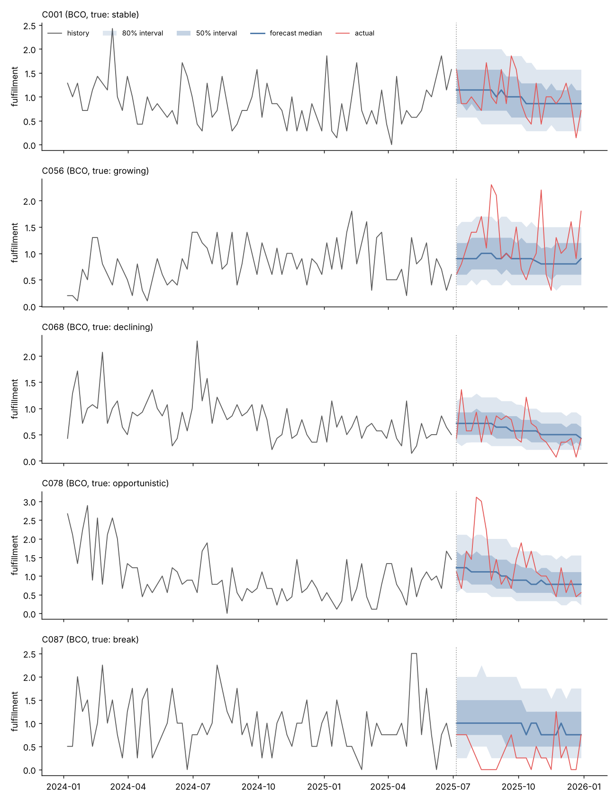

# fulfillcast

Hierarchical Bayesian forecasting of **contract fulfillment** for container shipping, with
probabilistic **behaviour segmentation** and **drift detection**.

Large contract customers commit to a weekly volume, but they don't always use it. Weekly
fulfillment (bookings / commitment) looks very noisy. The model treats it as noise around a
stable latent rate, and describes each customer by four behaviour parameters:

| Parameter | Meaning |
| --- | --- |
| `alpha` | level: typical fulfillment (e^alpha) at the middle of the training window |
| `b` | trend per year (log scale): growing or declining |
| `s` | volatility: typical size of the short-term deviation from trend |
| `beta` | price sensitivity to the spot–contract spread: opportunistic switching |

## The model

```
bookings[c,t]   ~ NegBinomial(commitment[c,t] * lambda[c,t], phi)
log lambda[c,t] = alpha_c + b_c * t + beta_c * spread[c,t] + season_k(t) + u[c,t]
u[c,t]          = rho_k * u[c,t-1] + tau_c * eps[c,t]          latent AR(1), tau_c = s_c * sqrt(1 - rho_k^2)
(alpha_c, b_c, log s_c, beta_c) ~ StudentT(nu, mu_k, sigma_k)   k = customer type (BCO / forwarder)
```

* `log(commitment)` is an offset, so the latent rate is "expected fulfillment".
* Customers borrow strength from their type (partial pooling). A new customer starts at its type average.
* Fitted with NUTS (PyMC + nutpie). Every output is computed per posterior draw, so uncertainty flows into everything.

## Synthetic data

`simulate_bookings()` creates a known ground truth so the model can be tested:

* 100 customers: 90 BCOs and 10 forwarders; forwarders have larger commitments and ~40% of weekly bookings
* 104 weeks, every week starting on a Sunday (2024-01-07 to 2025-12-28), 4 trade lanes with spot-rate cycles
* planted behaviours: stable, growing, declining, opportunistic (high `beta`), and break (sudden drop in year 2)

## Quickstart (Windows, PowerShell, in VS Code's terminal)

```powershell
cd "C:\Users\Mohammad\Documents\Python Scripts\projects\contract-fulfillment-forecast"
py -m venv .venv
.venv\Scripts\Activate.ps1
pip install -e ".[dev]"

pytest -m "not slow"                       # fast tests, ~2 s
python scripts/run_pipeline.py --quick     # smoke test, a few minutes
python scripts/run_pipeline.py             # full run: 4 chains x 1000 draws
pytest -m slow                             # parameter-recovery test (runs MCMC)
```

VS Code: rename the `vscode-settings` folder to `.vscode` (test discovery, ruff on save, run
configurations), open the folder, pick the `.venv` interpreter, and use the Testing panel or the
"Pipeline (quick)" run configuration. Outputs go to `outputs/`.

## Using the package

```python
from fulfillcast import (simulate_bookings, split_by_date, prepare_model_data, fit, FitConfig,
                         forecast, segment_probabilities, surprise_report)

sim = simulate_bookings()
weeks = sorted(sim.bookings["week_start"].unique())
train, test = split_by_date(sim.bookings, weeks[77])        # 78 weeks to fit, 26 to forecast

data = prepare_model_data(train)                            # validates the table (Pandera)
result = fit(data, FitConfig())                             # NUTS
result.save("outputs/fit.pkl")

fc = forecast(result, test, spread_scenario="ar1")          # future spread simulated
fc.fulfillment_summary()                                    # median, 80% interval, P(fulfillment < 0.6)

segment_probabilities(result)                               # P(segment) per customer

monitor = forecast(result, test, spread_scenario="observed")  # market known after the fact
surprise_report(monitor, test)                              # drift alarms
```

## Package layout

```
src/fulfillcast/
  config.py       Pydantic configs (simulation, fit), unknown keys rejected
  schemas.py      Pandera schema for the bookings table (Sundays, no duplicates, complete panel)
  simulate.py     synthetic data with ground truth
  features.py     Fourier seasonality, time features
  data.py         wide arrays + training-window transforms (no leakage)
  model.py        PyMC model, fit, FitResult (save / load)
  forecast.py     posterior predictive simulation, spread scenarios
  segments.py     probabilistic behaviour segments, parameter summaries
  drift.py        surprise (cumulative PIT / CUSUM), deviation, parameter shift between fits
  diagnostics.py  convergence quality gate (R-hat, ESS, divergences)
  evaluation.py   recovery, coverage, CRPS, baseline
  plotting.py     history + forecast fan per customer
scripts/run_pipeline.py   end-to-end run
tests/                    unit tests (no MCMC) + one slow recovery test
```

## Results on the synthetic data (full run, 78 weeks fit, 26 weeks forecast)



**Sampling.** 0 divergences. The convergence gate (R-hat ≤ 1.01, bulk ESS ≥ 400) does **not**
pass yet: max R-hat 1.03, min ESS 147. All failures are in the volatility block
(`rho`, `sigma[log_s]`, a few customer `log_s`, `phi`). The data separate "size of shocks",
"how long they last" and "booking noise" only weakly. Next step: longer chains, or volatility
pooled at type level.

**Parameter recovery** (true vs posterior mean, 100 customers):

| Parameter | Correlation | 80% interval coverage |
| --- | --- | --- |
| level `alpha` | 0.90 | 0.79 |
| price sensitivity `beta` | 0.95 | 0.83 |
| trend `b` | 0.68 | 0.74 |
| volatility `s` | 0.37 | 0.63 |

Price sensitivity is recovered best. Trends have the right sign for 22 of 25 trending customers
but are shrunk toward zero: 1.5 years of noisy weekly data pin a small customer's trend down only
loosely (posterior sd ~0.14 per year).

**Forecast of fulfillment over the 26-week horizon** (baseline = last 26 weeks' realized fulfillment):

| Spread scenario | 80% coverage | MAE model | CRPS model | MAE = CRPS baseline |
| --- | --- | --- | --- | --- |
| `ar1` (realistic) | 0.65 | 0.215 | 0.154 | 0.193 |
| `persistence` | 0.59 | 0.247 | 0.186 | 0.193 |
| `observed` (oracle) | 0.71 | 0.152 | 0.108 | 0.193 |

The model beats the baseline on CRPS, but its median is worse than the baseline when the future
spread is unknown. With the true market it is clearly better. So **forecasting the market is the
bottleneck**, not the customer model. Using realized future spreads to report accuracy would
overstate it (train–serve skew). Intervals are still too narrow (0.65 vs 0.80); part of that is
the 5 break customers, which no forecast can anticipate.

**Segments** (assigned only when P ≥ 0.8): 10 of 12 opportunistic customers labelled
price-driven with no false positives; most growing/declining customers are "uncertain"
rather than wrongly labelled.

**Drift** (cumulative-PIT rule, alpha = 0.01, realized spread): 4 of 5 break customers flagged,
5 alarms among 58 stable customers. The CUSUM rule catches all 5 breaks but raises more false
alarms (11 of 58).

## Next steps

* Git + GitHub Actions: lint (ruff), fast tests on every push, slow recovery test nightly
* Longer chains / volatility pooling to pass the convergence gate
* Rolling refits with `compare_fits` for parameter drift
* Control for lane-level market demand, so `beta` reads as "more price-sensitive than peers"
* Hurdle model for lumpy shippers; a market model for the spread
